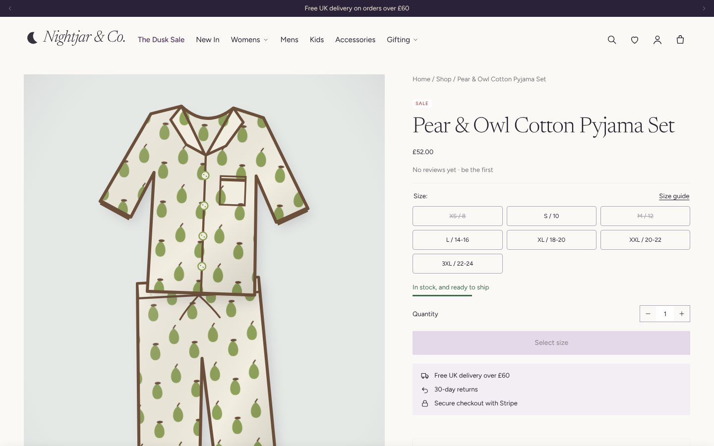
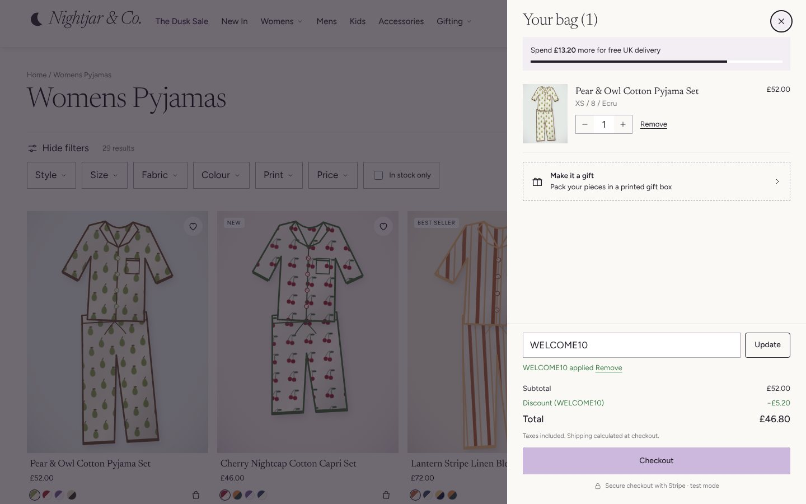
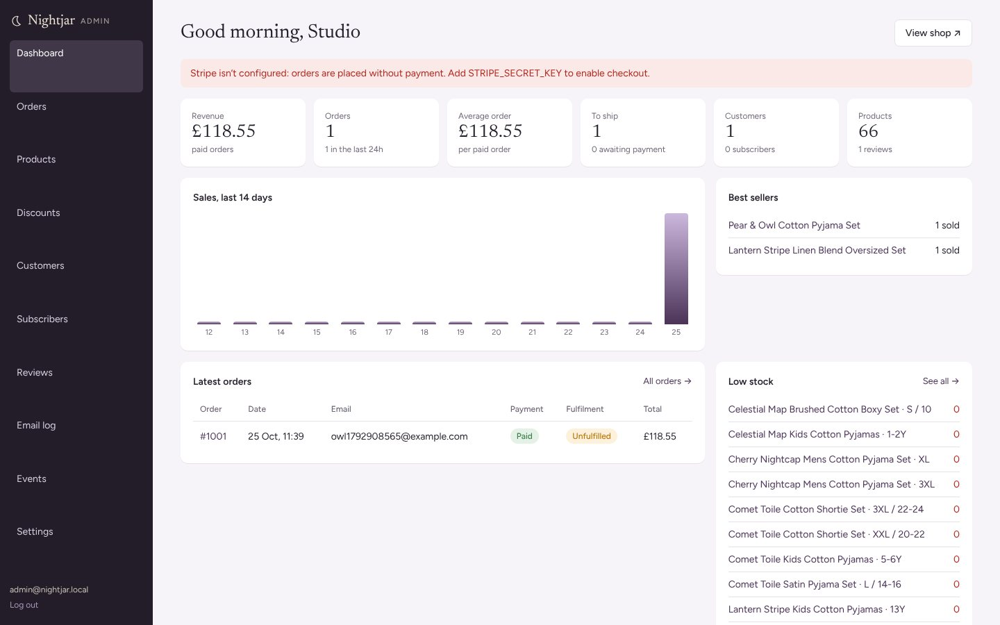

# Nightjar & Co.

**Print-led pyjamas for slow nights.** A complete, working online shop for a fictional London sleepwear label. It covers the whole path from storefront to back office: browse, filter, add a size from a product card, build a gift box, pay with Stripe, get a confirmation email, track the order in your account, and let staff ship, refund and restock it from an admin.

**Live:** [nightjar-and-co.vercel.app](https://nightjar-and-co.vercel.app) · Payments run in **Stripe test mode**. Pay with `4242 4242 4242 4242`, any future date and any CVC. No real money is taken and nothing ships.


| Product page | Bag, discount and free-delivery bar | Store admin |
| --- | --- | --- |
|  |  |  |

## What works

**Storefront**
- Homepage made of reorderable sections (a JSON template, like Shopify's): an autoplaying slideshow whose dots fill up as each slide plays, tabbed product sliders, collection tiles, split heroes, a "shop the print" flat lay with pulsing hotspots, and a trust bar.
- Collections built from rules (new in, best sellers, by fabric, by print, gifts under £25/£50, the sale), with filters for style, size, fabric, colour, print, price range and stock, plus sorting and pagination.
- Product cards with a second image on hover, one-click **size chips** that add straight to the bag, colourway swatches, badges and wishlist hearts.
- Product pages with a size grid, live stock messages, a size guide, a sticky add-to-bag bar, an image lightbox, **"Complete the set"** upsells and recommendations.
- Slide-out bag with a free UK delivery progress bar, quantity changes, discount codes, and a points-based **gift box builder** whose limits are checked on the server.
- Predictive search, a newsletter popup and footer signup (which sends a welcome code), and SEO basics: sitemap, robots.txt, canonical URLs, Open Graph tags and Product structured data.

**Checkout and orders**
- The checkout collects contact and delivery details and offers shipping rates by country, then hands off to **Stripe Checkout**. The discount is applied in Stripe as a one-off coupon.
- Stock is **reserved when the order is created**, inside a database transaction that can never take stock below zero. The order stays `pending` until Stripe confirms payment, through the **signed webhook** or the return page, whichever arrives first. Confirming is idempotent, so it only takes effect once. Unpaid orders release their stock when the Stripe session expires or the shopper goes back.
- The order status page shows a progress timeline and tracking details. Confirmation, shipping and refund emails are sent.

**Customer accounts**
- Register, log in, log out and reset a password. Passwords are hashed with scrypt; sessions use HttpOnly cookies and only a hash of the token is stored. Failed logins are throttled.
- Order history and a saved delivery address that pre-fills checkout. Guest orders appear in the account when the shopper registers with the same email.
- The wishlist is stored on the server and follows the shopper across devices. Hearts saved before logging in are merged into the account.
- Product reviews with star ratings. Reviewers who bought the item get a **"Verified buyer"** badge, and ratings are recalculated on every change.

**Store admin (`/admin`)**
- Dashboard: revenue, order count, average order value, orders to ship, a 14-day sales chart, best sellers and low stock.
- Orders: filter and search, view the line items and timeline, **mark as shipped** with carrier and tracking (and email the customer), **refund through Stripe** (full or partial, with optional restock), cancel unpaid orders, and keep internal notes.
- Products: edit the title, description, status (active, draft or archived), tags, images, and each variant's price, compare-at price, stock and SKU. **Create new products** from a print and a style; their images are drawn automatically.
- Discount codes (percentage or fixed amount, minimum spend, usage limit, end date), customers, subscribers with CSV export, review moderation, an email log, an event log, and a one-click **Stripe webhook connection**.

## How it's built

| Layer | Choice |
| --- | --- |
| Rendering | Server-rendered HTML from small JavaScript "section" functions, structured like a Shopify theme (layout, sections, snippets, JSON templates) |
| Front end | Plain JavaScript modules with no framework: a data-attribute component loader, a cart request queue, and section re-rendering after every cart change |
| Motion | An IntersectionObserver reveal engine with staggered CSS timing, one easing curve and three durations, switched off before first paint for visitors who prefer reduced motion |
| Backend | Node on **Vercel Functions**: one request handler that serves the Shopify-compatible AJAX Cart API (`/cart/add.js`, `/cart/change.js`, `?sections=`) |
| Database | **Postgres on Neon** (PGlite, Postgres in WebAssembly, for local development), parameterised SQL, transactions for stock and payments |
| Payments | **Stripe Checkout** and Refunds over the REST API; webhook signatures verified with HMAC-SHA256 |
| Email | Every email is written to the database; it is also sent through Resend if `RESEND_API_KEY` is set |
| Security | Same-origin checks on form posts, a Content Security Policy that blocks framing, HttpOnly SameSite cookies, a spam-trap field on reviews, size limits on request bodies, escaped output everywhere |

```
api/index.js            Vercel Function entry
server/
  app.js                router: pages, cart API, checkout → Stripe, webhooks, accounts
  commerce.js           carts, discounts, shipping, stock reservation, orders, events
  stripe.js             Checkout Sessions, refunds, webhook signatures
  auth.js               accounts, sessions, throttling, password reset, wishlist
  admin.js              store admin
  catalog.js            in-memory catalog cache + collections, menus, pages
  query.js              filters, facet counts, sorting, search, recommendations
  reviews.js · email.js · images.js (product art drawn in SVG)
  schema.sql · seed.js  database schema and the launch catalog
theme/                  layout, sections, snippets, templates, assets (CSS + JS)
```

## Run it locally

```bash
npm install
npm run dev            # http://localhost:3000, using an embedded Postgres in .data/
```

Without `STRIPE_SECRET_KEY` the checkout places orders without payment, so every flow can still be tried. The local admin is `admin@nightjar.local` / `nightjar-admin`.

| Environment variable | Purpose |
| --- | --- |
| `DATABASE_URL` | Postgres connection (added automatically by the Neon integration on Vercel) |
| `STRIPE_SECRET_KEY` | Stripe secret key (use a `sk_test_` key) |
| `STRIPE_WEBHOOK_SECRET` | Optional; the admin's **Connect Stripe webhooks** button stores one for you |
| `ADMIN_EMAIL`, `ADMIN_PASSWORD` | The store admin account, created or updated on start-up |
| `RESEND_API_KEY`, `EMAIL_FROM` | Optional, to deliver emails |

Demo discount codes: `WELCOME10` (10% off), `NIGHTOWL15` (15% off), `FIVEOFF` (£5 off orders over £40).

---

Nightjar & Co., its prints and copy are invented for this portfolio project. Lifestyle photos are from Unsplash; product images are drawn in code. The layout studies the conversion patterns of a print-led sleepwear store, rebuilt from scratch with an original brand. Built by **Hussain Singapuri** ([@huss2003](https://github.com/huss2003)).
